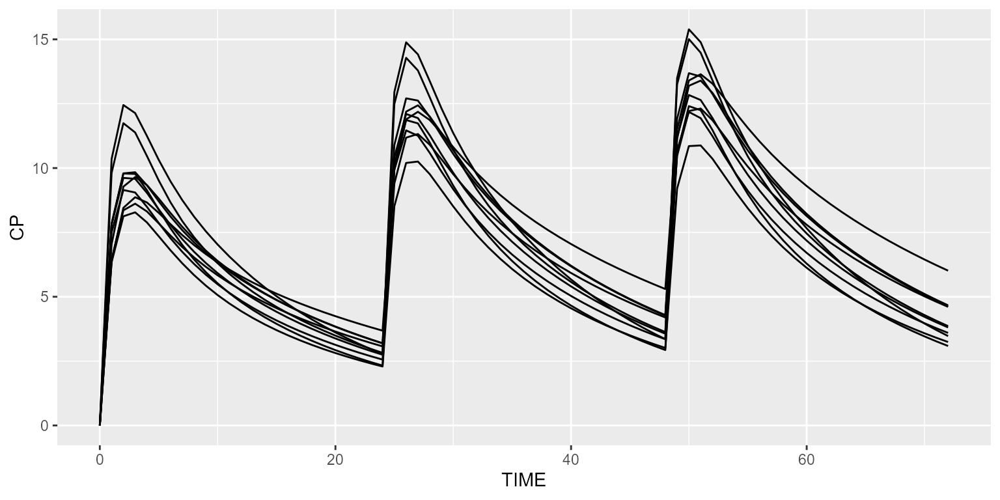
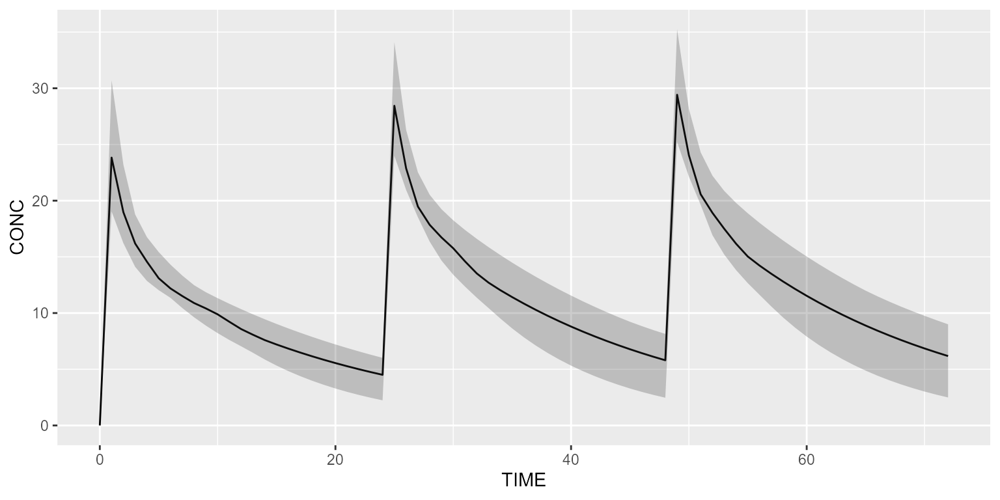
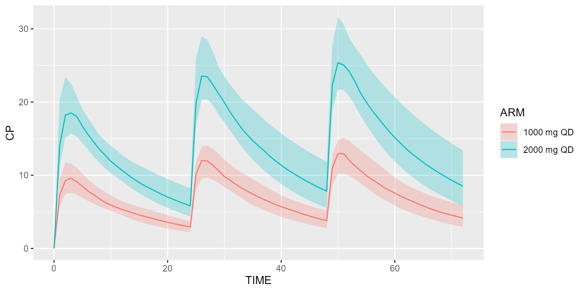

# Get started with Campsis

### Library import

First import the `campsis` package:

``` r

library(campsis)
```

### Load model

Load 2-compartment PK model from built-in model library:

``` r

model <- model_suite$pk$`2cpt_fo`
```

### Create dataset

Create your dataset in Campsis. For instance, let’s give 1000mg QD for 3
days and observe every hour.

``` r

dataset <- Dataset(10) %>%
  add(Bolus(time=0, amount=1000, ii=24, addl=2)) %>%
  add(Observations(times=seq(0,72, by=1)))
```

### Simulate

Simulate this very simple protocol:

``` r

results <-  simulate(model=model, dataset=dataset, seed=1)
head(results)
```

    ## # A tibble: 6 × 8
    ##      ID  TIME   ARM  A_ABS A_CENTRAL A_PERIPHERAL   CONC CONC_ERR
    ##   <dbl> <dbl> <dbl>  <dbl>     <dbl>        <dbl>  <dbl>    <dbl>
    ## 1     1     0     0   0           0            0   0.001  0.00113
    ## 2     1     1     0 383.        253.         328. 18.1   15.8    
    ## 3     1     2     0 147.        219.         555. 15.7   16.6    
    ## 4     1     3     0  56.1       194.         632. 13.9   12.2    
    ## 5     1     4     0  21.5       180.         647. 12.9   11.5    
    ## 6     1     5     0   8.22      170.         637. 12.2   12.1

### Plot results

Plot these results:

``` r

spaghetti_plot(results)
```



A shaded plot may also be used:

``` r

shaded_plot(results)
```



### Simulate 2 arms

We can also simulate two different treatment arms. Say the first arm
receives 1000mg QD and the second arm 2000mg QD. This can be implemented
as follows:

``` r

# First treatment arm
arm1 <- Arm(subjects=50, label="1000 mg QD") %>%
  add(Bolus(time=0, amount=1000, ii=24, addl=2)) %>%
  add(Observations(times=seq(0,72, by=1)))

# Second treatment arm
arm2 <- Arm(subjects=50, label="2000 mg QD") %>%
  add(Bolus(time=0, amount=2000, ii=24, addl=2)) %>%
  add(Observations(times=seq(0,72, by=1)))

dataset <- Dataset() %>% add(c(arm1, arm2))

results <- simulate(model=model, dataset=dataset, seed=1)
shaded_plot(results)
```



### Going further

We invite you to check out the other
[vignettes](https://calvagone.github.io/campsis.doc/articles/). Have fun
with Campsis!
