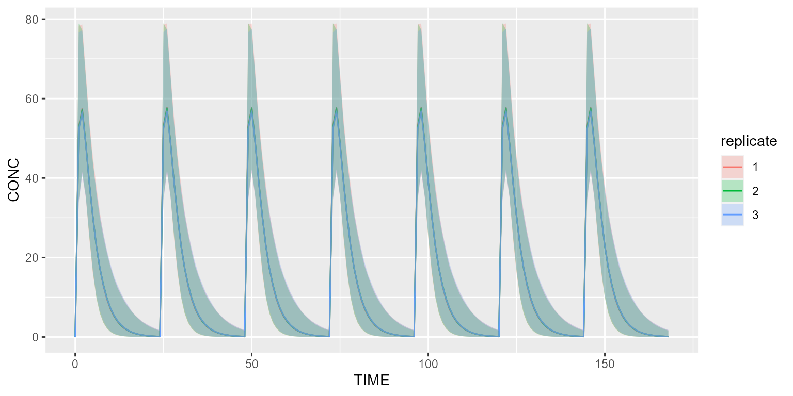

# Progress bar

This vignette explains how you can track the simulation progress thanks
to the package `progressr`.

### Track the simulation progress in an R script

Load package `progressr` as follows:

``` r

library(progressr)
```

The easiest way to track the progress is to add the following snippet
once for all in your script. By doing so, any call to the simulate
method of `campsis` will display the progress bar.

``` r

handlers(global = TRUE)
```

By default, the progress bar will only give the progress as a
percentage. Any user-custom handler may be provided. Please have a look
at the official
[documentation](https://CRAN.R-project.org/package=progressr) (Vignette
`progressr`: An Introduction / ‘Customizing how progress is reported’).

If you want to use the default handler from `campsis`, which gives you
more details about what’s being simulated and what’s the remaining time
(ETA), you can write:

``` r

handlers(campsis_handler())
```

If you don’t want your handler(s) to be global, you can also explicitly
call the method `with_progress`. The snippet below is an example of
simulation where this method is called.

``` r

dataset <- Dataset(1000) %>%
  add(Infusion(time = 0, amount = 1000, compartment = 1, ii = 24, addl = 6)) %>%
  add(Observations(seq(0, 7 * 24)))

model <- model_suite$pk$`1cpt_fo`
results <- with_progress(simulate(
  model = model,
  dataset = dataset,
  dest = "mrgsolve",
  seed = 1,
  replicates = 3
))
shadedPlot(results, "CONC", "replicate")
```



Any handler may be provided as well:

``` r

results <- with_progress(
  simulate(
    model = model,
    dataset = dataset,
    dest = "mrgsolve",
    seed = 1,
    replicates = 3
  ),
  handlers = campsis_handler()
)
```

### Track the simulation progress in a targets project

The [targets](https://books.ropensci.org/targets/) package is a
Make-like pipeline tool for Statistics and data science in R. With
targets, you can maintain a reproducible workflow without repeating
yourself. It is the ideal pipeline tool to use for medium to large
simulation projects with Campsis.

The following script (`_targets.R`) gives you a brief overview of what
you can achieve with targets and how the progress bar can be enabled. It
is important to mention that `handlers(global=TRUE)` can’t be used in
such a script. If you try to do so, an error message will pop up.

``` r

library(targets)

source("R/my_script.R")

# Packages loaded by targets
packages <- c("campsis", "progressr")
tar_option_set(packages = packages)

# Enable progress bar
options(progressr.enable = TRUE)
progressr::handlers(campsis::campsis_handler())

list(
  tar_target(
    model,
    model_suite$pk$`1cpt_fo`
  ),
  tar_target(
    dataset,
    make_dataset(subjects = 1000, dose = 1000)
  ),
  tar_target(
    results,
    run_simulation(model = model, dataset = dataset, replicates = 3)
  )
)
```

The R folder contains as much as possible of the code (or logic) being
executed, in the form of R functions. The snippet below shows the
content of `my_script.R`. An explicit call to `with_progress` will make
the progress bar appear when executing the target `results`.

``` r

make_dataset <- function(subjects, dose) {
  dataset <- Dataset(subjects = subjects) %>%
    add(Infusion(
      time = 0,
      amount = dose,
      compartment = 1,
      ii = 24,
      addl = 6
    )) %>%
    add(Observations(seq(0, 7 * 24)))
  return(dataset)
}

run_simulation <- function(model, dataset, replicates) {
  results <- with_progress(simulate(
    model = model,
    dataset = dataset,
    dest = "mrgsolve",
    seed = 1,
    replicates = replicates
  ))
  return(results)
}
```

This small project can be downloaded by clicking the link below.

[Download targets
squeletton]()

To run this project, simply open an R console within your targets folder
and type:

``` r

library(targets)
tar_make()
```
