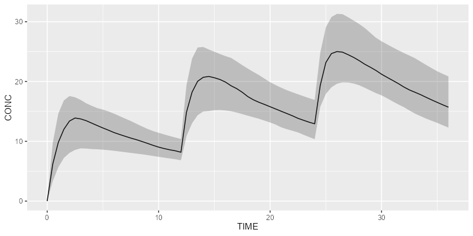

# campsis

## Requirements

- R package `campsismod` must be installed beforehand
- Simulation engine must be installed too (`rxode2` or `mrgsolve`)

## Installation

Install the latest stable release using `devtools`:

``` r

devtools::install_github("Calvagone/campsis")
```

## Basic example

Import the `campsis` package:

``` r

library(campsis)
```

Create your dataset:

``` r

ds <- Dataset(50) %>%
  add(Bolus(time = 0, amount = 1000, ii = 12, addl = 2)) %>%
  add(Observations(times = seq(0, 36, by = 0.5)))
```

Load your own model or use a built-in model from the library:

``` r

model <- model_suite$pk$`2cpt_fo`
```

Simulate your results with your preferred simulation engine (`rxode2` or
`mrgsolve`):

``` r

results <- simulate(model = model, dataset = ds, dest = "mrgsolve", seed = 1)
```

Plot your results:

``` r

shaded_plot(results, "CONC")
```


